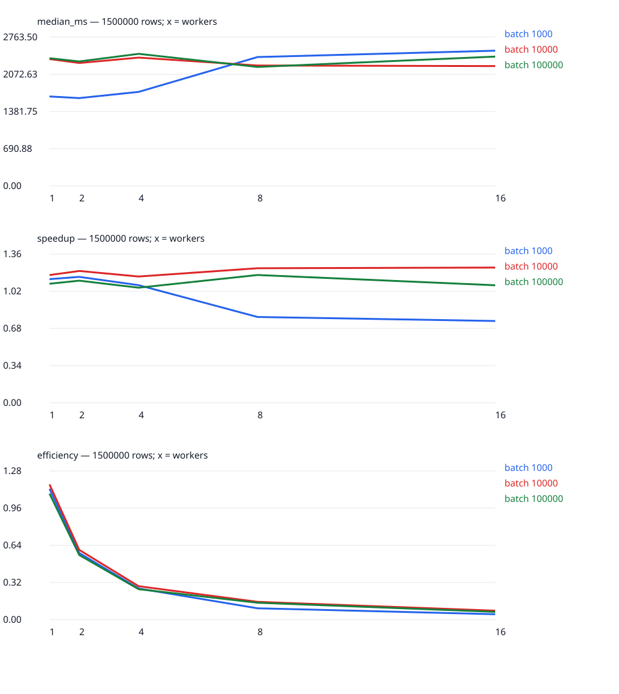

# Измерения параллельного анализа

Фактические время и окружение запуска: [environment.txt](results/environment.txt).
Все повторы: [runs.csv](results/runs.csv), медианы: [summary.csv](results/summary.csv).
Время в миллисекундах; S = Tseq / Tparallel, E = S / workers.

| Строк | Батч | Потоки | Последовательно, мс | Параллельно, мс | S | E |
|---:|---:|---:|---:|---:|---:|---:|
| 10000 | 1000 | 1 | 24.152 | 15.249 | 1.584 | 1.584 |
| 10000 | 1000 | 2 | 24.152 | 13.077 | 1.847 | 0.923 |
| 10000 | 1000 | 4 | 24.152 | 11.128 | 2.170 | 0.543 |
| 10000 | 1000 | 8 | 24.152 | 10.722 | 2.253 | 0.282 |
| 10000 | 1000 | 16 | 24.152 | 12.930 | 1.868 | 0.117 |
| 10000 | 10000 | 1 | 11.460 | 12.901 | 0.888 | 0.888 |
| 10000 | 10000 | 2 | 11.460 | 12.236 | 0.937 | 0.468 |
| 10000 | 10000 | 4 | 11.460 | 14.087 | 0.814 | 0.203 |
| 10000 | 10000 | 8 | 11.460 | 12.179 | 0.941 | 0.118 |
| 10000 | 10000 | 16 | 11.460 | 12.118 | 0.946 | 0.059 |
| 10000 | 100000 | 1 | 10.971 | 12.425 | 0.883 | 0.883 |
| 10000 | 100000 | 2 | 10.971 | 11.849 | 0.926 | 0.463 |
| 10000 | 100000 | 4 | 10.971 | 13.017 | 0.843 | 0.211 |
| 10000 | 100000 | 8 | 10.971 | 13.719 | 0.800 | 0.100 |
| 10000 | 100000 | 16 | 10.971 | 13.503 | 0.812 | 0.051 |
| 100000 | 1000 | 1 | 124.177 | 112.878 | 1.100 | 1.100 |
| 100000 | 1000 | 2 | 124.177 | 95.627 | 1.299 | 0.649 |
| 100000 | 1000 | 4 | 124.177 | 101.942 | 1.218 | 0.305 |
| 100000 | 1000 | 8 | 124.177 | 119.034 | 1.043 | 0.130 |
| 100000 | 1000 | 16 | 124.177 | 116.772 | 1.063 | 0.066 |
| 100000 | 10000 | 1 | 134.063 | 103.907 | 1.290 | 1.290 |
| 100000 | 10000 | 2 | 134.063 | 110.519 | 1.213 | 0.607 |
| 100000 | 10000 | 4 | 134.063 | 92.810 | 1.444 | 0.361 |
| 100000 | 10000 | 8 | 134.063 | 88.332 | 1.518 | 0.190 |
| 100000 | 10000 | 16 | 134.063 | 95.101 | 1.410 | 0.088 |
| 100000 | 100000 | 1 | 118.525 | 129.980 | 0.912 | 0.912 |
| 100000 | 100000 | 2 | 118.525 | 122.808 | 0.965 | 0.483 |
| 100000 | 100000 | 4 | 118.525 | 145.346 | 0.815 | 0.204 |
| 100000 | 100000 | 8 | 118.525 | 140.845 | 0.842 | 0.105 |
| 100000 | 100000 | 16 | 118.525 | 129.352 | 0.916 | 0.057 |
| 1500000 | 1000 | 1 | 1876.689 | 1661.779 | 1.129 | 1.129 |
| 1500000 | 1000 | 2 | 1876.689 | 1631.604 | 1.150 | 0.575 |
| 1500000 | 1000 | 4 | 1876.689 | 1747.141 | 1.074 | 0.269 |
| 1500000 | 1000 | 8 | 1876.689 | 2394.440 | 0.784 | 0.098 |
| 1500000 | 1000 | 16 | 1876.689 | 2512.276 | 0.747 | 0.047 |
| 1500000 | 10000 | 1 | 2749.547 | 2356.378 | 1.167 | 1.167 |
| 1500000 | 10000 | 2 | 2749.547 | 2283.898 | 1.204 | 0.602 |
| 1500000 | 10000 | 4 | 2749.547 | 2384.008 | 1.153 | 0.288 |
| 1500000 | 10000 | 8 | 2749.547 | 2237.305 | 1.229 | 0.154 |
| 1500000 | 10000 | 16 | 2749.547 | 2226.295 | 1.235 | 0.077 |
| 1500000 | 100000 | 1 | 2579.707 | 2372.283 | 1.087 | 1.087 |
| 1500000 | 100000 | 2 | 2579.707 | 2312.720 | 1.115 | 0.558 |
| 1500000 | 100000 | 4 | 2579.707 | 2453.870 | 1.051 | 0.263 |
| 1500000 | 100000 | 8 | 2579.707 | 2210.226 | 1.167 | 0.146 |
| 1500000 | 100000 | 16 | 2579.707 | 2403.027 | 1.074 | 0.067 |

## Наблюдения

Для 10000 строк лучшее измеренное время: 10.722 мс, батч 1000, потоков 8, ускорение 2.253.

Для 100000 строк лучшее измеренное время: 88.332 мс, батч 10000, потоков 8, ускорение 1.518.

Для 1500000 строк лучшее измеренное время: 1631.604 мс, батч 1000, потоков 2, ускорение 1.150.

На полном входе с батчем 1000 минимум при 2 потоках (1631.604 мс); при 16 потоках 2512.276 мс. Это граница полезного масштабирования среди проверенных конфигураций, а не универсальный предел.

На полном входе с батчем 10000 минимум при 16 потоках (2226.295 мс); при 16 потоках 2226.295 мс. Это граница полезного масштабирования среди проверенных конфигураций, а не универсальный предел.

На полном входе с батчем 100000 минимум при 8 потоках (2210.226 мс); при 16 потоках 2403.027 мс. Это граница полезного масштабирования среди проверенных конфигураций, а не универсальный предел.

## Ограничения и узкие места

Читающий поток выполняет весь парсинг до отправки батча. Его работа остаётся последовательной. Пул распараллеливает только агрегацию; объединение карт выполняется последовательно. Каждый батч создаёт отдельные карты, включая карту IP. Малые батчи увеличивают число задач и объединений; крупные батчи уменьшают их число, но на небольшом входе оставляют часть пула без работы. Лимит задач сдерживает память батчей, однако итоговая карта IP растёт с числом уникальных адресов.

Эти свойства кода объясняют возможное ограничение ускорения. Доля CPU, GC, диска и ожиданий отдельно не измерялась, поэтому по таблице нельзя точно приписать замедление одному из них. Использованы два прогрева и три повтора; медиана уменьшает влияние единичных выбросов, но не заменяет доверительные интервалы. Фиксированный порядок и прогретый файловый кеш ограничивают переносимость результатов. Замеры сделаны в указанную в environment.txt дату; даты коммитов заданы отдельно по запросу автора.

## Дополнительный вариант

Общую конкурентную агрегацию рассмотрели как альтернативу: она убирает merge локальных карт, но требует потокобезопасных счётчиков и обновления минутных окон. Существующий LogEngine умеет вызывать общие обработчики, однако текущая AnalysisStatistics для этого не предназначена. Отдельный вариант не реализован и не измерен. Следующий полезный эксперимент — перенос парсинга в рабочие потоки с ограниченной очередью сырых строк; сейчас последовательный парсинг ограничивает оба варианта агрегации.
